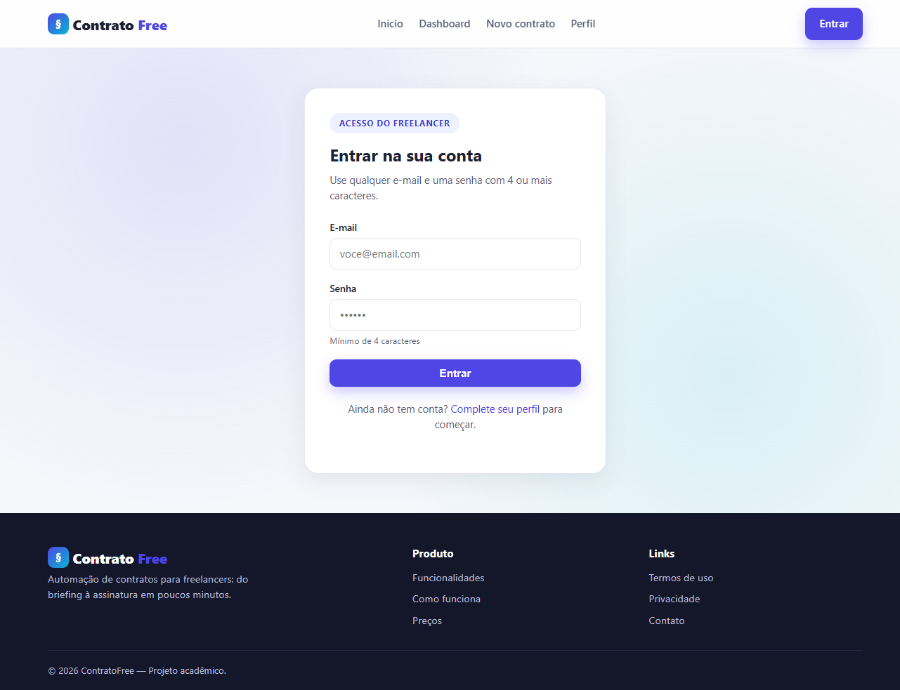
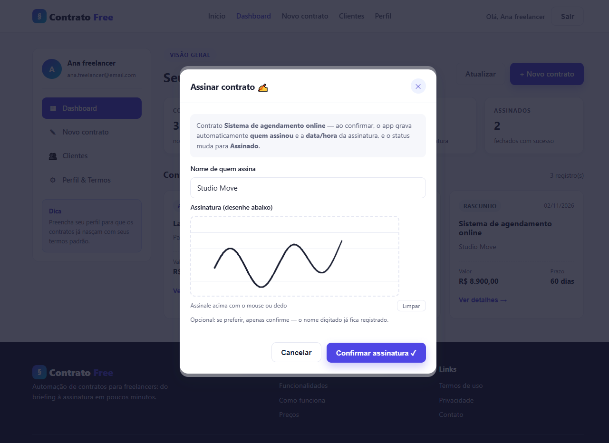
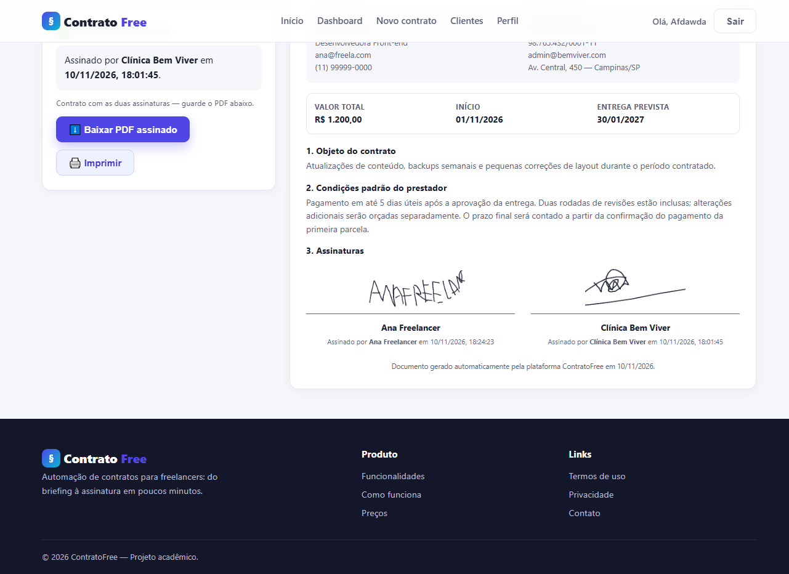

# 📄 ContratoFree — Automação de Contratos para Freelancers

> Plataforma web desenvolvida em **React.js + TypeScript (Vite)** com **API REST
> (Express + PostgreSQL)** e serviços gerenciados no **Neon**: banco **PostgreSQL**
> (branch `production`) e login com **Neon Auth** (Managed Better Auth).

O freelancer preenche um wizard curto (cliente → escopo e valores → revisão), a
plataforma monta o contrato com os termos padrão salvos no perfil, exibe uma prévia em
tempo real e permite salvar, **enviar o link de assinatura para o cliente**, acompanhar
métricas no dashboard e **baixar o PDF assinado** (ou imprimir).

**Funcionalidades completas de gestão:**

- ✏️ **Editar contratos** (`/novo-contrato/:id`) — abra qualquer contrato pelo dashboard
  e refaça as etapas do wizard com os dados já preenchidos;
- 🗑️ **Excluir contratos** — com modal de confirmação no painel;
- ✍️ **Assinatura em duas partes** — o contrato tem dois espaços de assinatura:
  **prestador** (o freelancer, pelo dashboard, em “Assinar como → Prestador”) e
  **contratante** (o cliente, pelo link público). Cada assinatura é **desenhada em um
  canvas** (ou só se confirma o nome), fica **alinhada por cima da linha do nome**
  na prévia e no PDF, e o app **grava automaticamente quem assinou e a data/hora**
  (carimbo no card, nos detalhes, na prévia e no PDF). O contrato só fica *Assinado*
  quando as **duas** assinaturas estão registradas;
- 🔗 **Link de assinatura para o cliente** — cada contrato gera um endereço público
  (`/assinar/:id`) que o cliente abre **sem criar conta**, lê o documento e assina no
  próprio ContratoFree; os detalhes do contrato e o modal de sucesso trazem um bloco
  para **copiar o link** ou **abrir um e-mail** com ele;
- ⬇️ **Download do PDF assinado** — botão “Baixar PDF” gera o arquivo real (jsPDF)
  com o contrato, as assinaturas desenhadas e os carimbos de data/hora — disponível
  nos detalhes do contrato, no wizard e na página pública;
- 👥 **Agenda de clientes** (`/clientes`) — cadastro, edição e exclusão de clientes,
  com contagem de contratos vinculados;
- 💾 **Persistência real no Neon (PostgreSQL)** — a API em `server/` grava contratos,
  clientes e perfil no PostgreSQL do Neon (branch `production`); os clientes são
  reutilizáveis no wizard por um seletor;
- 🔐 **Login real com Neon Auth** — cadastro e entrada com e-mail/senha (mínimo de 8
  caracteres) gerenciados pelo **Neon Auth (Managed Better Auth)**, na mesma branch
  do banco: a sessão sobrevive ao F5 e as rotas internas ficam protegidas.

> ℹ️ **Modo mock (fallback):** sem `VITE_API_URL`, os dados ficam no `localStorage`
> do navegador e o link de assinatura abre **no mesmo navegador/computador**. Com a
> API real configurada, o cliente abre o link de qualquer lugar.

---

## 🚀 Instalação e execução

Pré-requisitos: [Node.js](https://nodejs.org) LTS (>= 18), npm e o
[Neon CLI](https://neon.com/docs/cli/introduction) (`npm i -g neon`).

```bash
# 1. Clone o repositório
git clone https://github.com/<seu-usuario>/contrato-free.git
cd contrato-free

# 2. Instale as dependências (front + API)
npm install
npm --prefix server install

# 3. Gere as variáveis do Neon (.env.local — gitignored)
neon login          # só na primeira vez (abre o navegador)
neon deploy         # provisiona Postgres + Auth e puxa DATABASE_URL, NEON_AUTH_*, VITE_*

# 4. Inicie API (http://localhost:3001) + front (http://localhost:5173)
npm run dev
```

> O `.env.local` traz `DATABASE_URL`/`DATABASE_URL_UNPOOLED` (Postgres),
> `NEON_AUTH_BASE_URL`/`NEON_AUTH_JWKS_URL` (Auth) e as variáveis `VITE_*` usadas
> pelo front (`VITE_API_URL`, `VITE_NEON_AUTH_URL`). É gerado pelo `neon deploy` —
> **nunca** versione esse arquivo.

### Scripts disponíveis

| Comando           | Descrição                                                  |
| ----------------- | ---------------------------------------------------------- |
| `npm run dev`     | API (Express, :3001) **e** front (Vite, :5173) juntos      |
| `npm run api`     | Só a API REST (`server/index.js`)                          |
| `npm run web`     | Só o front (Vite)                                          |
| `npm run build`   | Gera o build de produção em `dist/`                        |
| `npm run preview` | Visualiza o build de produção localmente                   |
| `npm run lint`    | Executa o linter (oxlint)                                  |

---

## 🧩 Estrutura do projeto

```
server/                  # API REST (Express + pg) ligada ao Neon Postgres
├── index.js             # Sobe o Express (CORS, /health, rotas, erros)
├── db.js                # Pools Neon (pooled p/ app, unpooled p/ schema) + seed
├── http.js              # Helpers httpError/wrap
├── routes/
│   ├── contracts.js     # CRUD + /sign (duas partes, transação)
│   ├── clients.js       # CRUD da agenda (upsert por e-mail)
│   └── profile.js       # GET/PUT do perfil (linha única)
├── seed.json            # Dados de exemplo (1ª execução do banco)
└── package.json         # express, cors, dotenv, pg
neon.ts                  # Configuração do Neon CLI (auth: true + branch policy)
src/
├── components/            # Componentes funcionais reutilizáveis
│   ├── Header.tsx         # Barra de navegação superior
│   ├── Footer.tsx         # Rodapé institucional
│   ├── Sidebar.tsx        # Menu lateral do painel
│   ├── Button.tsx         # Botão genérico com variantes
│   ├── Input.tsx          # Input / Textarea / Select (label, erro e hint)
│   ├── Modal.tsx          # Modal acessível (fecha com ESC)
│   ├── ContractCard.tsx   # Card de contrato na listagem
│   ├── ContractPreview.tsx# Prévia do contrato (área de impressão)
│   ├── Metric.tsx         # Card de métrica do dashboard
│   ├── SignaturePad.tsx   # Canvas de assinatura (desenho + limpar)
│   ├── ShareLink.tsx      # Bloco de compartilhar link (copiar + e-mail)
│   └── ProtectedRoute.tsx # Rota protegida por autenticação
├── context/
│   └── AuthContext.tsx    # Estado global de autenticação (Neon Auth)
├── hooks/
│   ├── useContracts.ts    # Custom hook de contratos (CRUD + assinar)
│   ├── useClients.ts      # Custom hook da agenda de clientes (CRUD)
│   └── useLocalStorage.ts # Custom hook de persistência (modo mock)
├── pages/                 # 7 páginas / rotas
│   ├── Home.tsx           # /                    → Landing page
│   ├── Login.tsx          # /login               → Entrar / Criar conta (Neon Auth)
│   ├── Dashboard.tsx      # /dashboard           → Contratos + métricas + editar/excluir/assinar
│   ├── NovoContrato.tsx   # /novo-contrato       → Wizard de geração
│   │                      # /novo-contrato/:id   → Edição de contrato
│   ├── Clientes.tsx       # /clientes            → Agenda de clientes (CRUD)
│   ├── Perfil.tsx         # /perfil              → Dados e termos padrão
│   └── Assinar.tsx        # /assinar/:id         → Assinatura PÚBLICA do cliente (sem login)
├── services/
│   ├── api.ts             # Camada de API (REST + fallback mock)
│   ├── auth.ts            # Cliente do Neon Auth (@neon/auth)
│   └── pdf.ts             # Geração do PDF do contrato (jsPDF, sob demanda)
├── types/
│   └── index.ts           # Tipos compartilhados (Contract, Profile…)
├── App.tsx                # Configuração das rotas (react-router-dom)
└── main.tsx               # Ponto de entrada (BrowserRouter + AuthProvider)
```

### Hooks utilizados

- `useState` — formulários do login, wizard do contrato, perfil e agenda de clientes.
- `useEffect` — busca inicial dos contratos/clientes, carregamento do perfil, sessão e
  pré-carregamento do contrato em modo edição.
- `useContext` — estado global de autenticação (`useAuth`).
- `useRef` — referência da div do contrato para impressão/exportação em PDF.
- **Custom hooks** — `useContracts` (CRUD de contratos), `useClients` (CRUD de
  clientes) e `useLocalStorage` (persistência).

---

## 🌩️ Neon (banco + login)

O projeto está vinculado ao Neon CLI (arquivo `.neon`, gitignored) com o projeto
`contratofree` na branch `production`:

| Serviço      | Como está ligado no código                                              |
| ------------ | ----------------------------------------------------------------------- |
| **Postgres** | `server/db.js` conecta com `pg`: `DATABASE_URL` (pooler) para a API e `DATABASE_URL_UNPOOLED` para criação de schema/seed — schema e seed rodam sozinhos na 1ª execução |
| **Neon Auth**| `src/services/auth.ts` cria o cliente com `@neon/auth` (`createAuthClient` + `BetterAuthReactAdapter`) apontando para `VITE_NEON_AUTH_URL`; `AuthContext` faz `signUp.email`, `signIn.email`, `getSession` e `signOut` |

Comandos úteis (requeem `neon login`):

```bash
neon deploy              # aplica neon.ts e (re)puxa as env vars para .env.local
neon neon-auth status    # mostra Base URL / JWKS do Auth da branch
neon env pull            # só atualiza as variáveis de ambiente
neon config plan         # mostra o que mudaria na política da branch (dry-run)
```

> O `neon.ts` declara `auth: true` e a política da branch (branches novas expiram em
> 7 dias). Não versione `.env.local` — ele contém a senha do banco.

---

## 🔌 Integração com API

A pasta `src/services/api.ts` expõe as funções `getContracts`, `getContract`,
`createContract`, `updateContract`, `deleteContract`, `signContract`, `getClients`,
`saveClient`, `updateClient`, `deleteClient`, `getProfile` e `updateProfile`.

- **Backend real (este repositório):** a API REST está implementada em `server/`
  (Express + `pg`) e grava no PostgreSQL do Neon. `npm run dev` sobe API + front
  juntos — é o modo padrão quando `.env.local` existe.
- **Modo mock (fallback):** enquanto `VITE_API_URL` não estiver definida, as funções
  retornam `Promise`s com dados simulados e latência de rede — e **persistem contratos,
  clientes e perfil no `localStorage`** (sobrevivem ao F5).

O contrato REST consumido por `services/api.ts` (já implementado no servidor):

| Método | Endpoint          | Descrição                             |
| ------ | ----------------- | ------------------------------------- |
| GET    | `/contracts`      | Lista os contratos                    |
| GET    | `/contracts/:id`  | Busca 1 contrato (usado pela página pública de assinatura) |
| POST   | `/contracts`      | Cria um novo contrato                 |
| PUT    | `/contracts/:id`  | Atualiza (edita) um contrato          |
| DELETE | `/contracts/:id`  | Exclui um contrato                    |
| POST   | `/contracts/:id/sign` | Assina como `prestador` ou `contratante` (`{ por, imagem?, quem }`) — grava data/hora automática e só muda o status para *assinado* quando **as duas** assinaturas existem |
| GET    | `/clients`        | Lista a agenda de clientes            |
| POST   | `/clients`        | Salva um cliente (upsert por e-mail)  |
| PUT    | `/clients/:id`    | Atualiza um cliente                   |
| DELETE | `/clients/:id`    | Exclui um cliente                     |
| GET    | `/profile`        | Retorna o perfil do freelancer        |
| PUT    | `/profile`        | Atualiza o perfil                     |
| GET    | `/health`         | Smoke test da API + banco             |

> Criar/editar um contrato também **sincroniza a agenda de clientes** (upsert por
> e-mail), dentro da mesma transação.

---

## 👥 Integração da equipe

> **Preencha a tabela abaixo com os dados do seu grupo.**

| Membro | Matrícula | Responsabilidade | Componentes/páginas desenvolvidos |
| ------ | --------- | ---------------- | --------------------------------- |
| _Nome_ | _Matrícula_ | _Role_         | _Ex.: Header, Footer, Home_       |
|        |            |                 |                                   |
|        |            |                 |                                   |
|        |            |                 |                                   |

---

## 🖼️ Prints das telas principais

> Substitua os exemplos pelas imagens dos seus prints (salve em `docs/print/` e
> referencie como ``).

### 1. Home (`/`)


### 2. Login (`/login`)



### 3. Dashboard (`/dashboard`)


### 4. Novo contrato (`/novo-contrato`)


### 5. Perfil (`/perfil`)


### 6. Clientes (`/clientes`)


### 7. Assinatura do contrato (modal: escolher prestador ou contratante)



### 8. Página pública de assinatura (`/assinar/:id`) — cliente assina sem login

> A assinatura de cada parte fica **alinhada por cima da linha do nome**, com o carimbo
> de data/hora embaixo — no contrato, no PDF e no envio por e-mail.



---

## 📦 Publicando no GitHub

1. Crie um repositório **público** vazio em <https://github.com/new>
   (sem README, sem .gitignore e sem license — o projeto já os possui).
2. Rode os comandos abaixo na pasta do projeto:

```bash
# Identificação (troque pelos dados reais do responsável pelo commit)
git config user.name "Seu Nome"
git config user.email "seu@email.com"

# Conecta o repositório local ao GitHub e envia o código
git remote add origin https://github.com/<seu-usuario>/contrato-free.git
git branch -M main
git push -u origin main
```

> Caso o Git não esteja no PATH da sua máquina, use o caminho completo do
> executável (ex.: `%USERPROFILE%\tools\mingit\cmd\git.exe push -u origin main`)
> ou instale o Git oficial em <https://git-scm.com/download/win>.

---

## ☁️ Deploy

### Vercel (recomendado)

1. Suba o código para um repositório público no GitHub.
2. Acesse [vercel.com/new](https://vercel.com/new) e importe o repositório.
3. A Vercel detecta automaticamente o projeto Vite. Mantenha:
   - **Framework preset:** Vite
   - **Build command:** `npm run build`
   - **Output directory:** `dist`
4. Adicione as variáveis de ambiente em *Settings → Environment Variables*:
   - `VITE_API_URL` — endereço público da API (`server/`);
   - `VITE_NEON_AUTH_URL` — URL pública do Neon Auth da branch (a mesma que o
     `neon deploy` grava como `NEON_AUTH_BASE_URL` no `.env.local`).
5. Clique em **Deploy**. Como o React Router usa rotas internas, a Vercel já
   redireciona tudo para `index.html` automaticamente.

### API (server/) em hospedagem Node (Render, Railway, Fly…)

1. Crie um **Web Service** apontando para o repositório.
2. Configure **Build:** `npm install && npm --prefix server install` e
   **Start:** `npm --prefix server start`.
3. Defina `DATABASE_URL` (e opcional `DATABASE_URL_UNPOOLED`) com o valor do seu
   `.env.local`. A `/health` responde `{"ok":true,...}` quando o banco responde.

### Render (só o front)

1. Crie um novo **Web Service** apontando para o repositório no GitHub.
2. Configure:
   - **Build Command:** `npm install && npm run build`
   - **Publish Directory:** `dist`
3. Adicione `VITE_API_URL` e `VITE_NEON_AUTH_URL`.
4. Clique em **Create Web Service**.

---

## ✅ Requisitos acadêmicos atendidos

- [x] React.js + TypeScript inicializado via **Vite**
- [x] **12 arquivos de componentes funcionais** em `src/components/` (14 componentes:
      `Input`, `Textarea` e `Select` contam como 3 — mínimo exigido: 8)
- [x] **7 páginas** com React Router: `/`, `/login`, `/dashboard`, `/novo-contrato`
      (e `/novo-contrato/:id` para edição), `/clientes`, `/perfil` e a página pública
      `/assinar/:id` (mínimo exigido: 5)
- [x] **7 hooks diferentes**: `useState`, `useEffect`, `useContext`, `useRef`
      + custom hooks `useContracts`, `useClients` e `useLocalStorage` (mínimo exigido: 4)
- [x] CRUD completo: editar/excluir contratos e cadastrar/editar/excluir clientes
      com persistência de dados
- [x] **Assinatura em duas partes** (prestador + contratante) com canvas, alinhada
      por cima da linha de cada nome, status automático para *assinado* quando as
      duas assinaturas existem e carimbo de data/hora registrado pelo app
- [x] **Link público de assinatura** (`/assinar/:id`) para o cliente assinar sem
      conta + **download do PDF assinado** (jsPDF) com assinaturas e carimbos
- [x] Camada de API preparada para backend REST (`src/services/api.ts`)
- [x] README com instalação, equipe, prints e instruções de deploy
