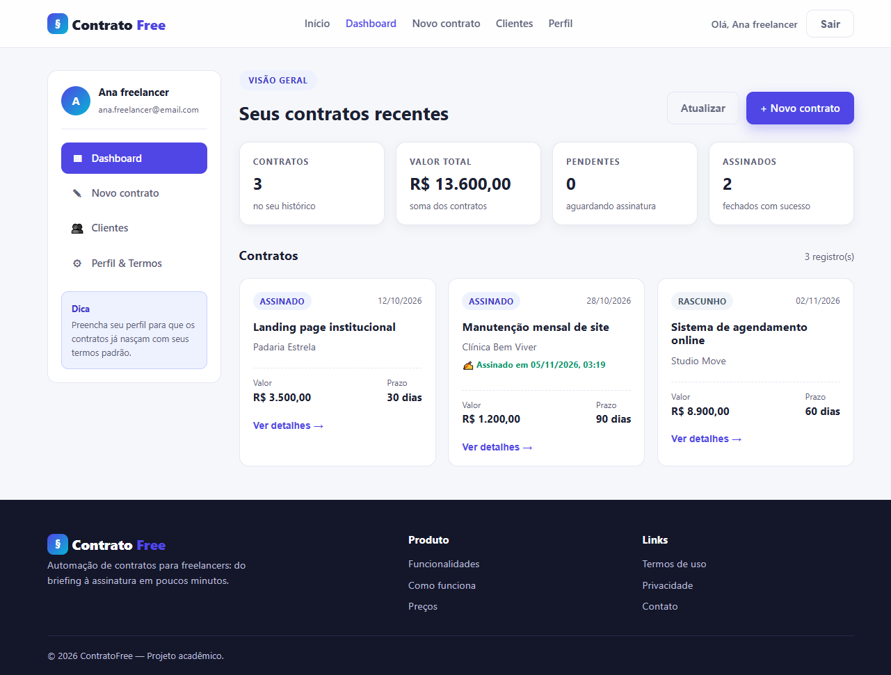
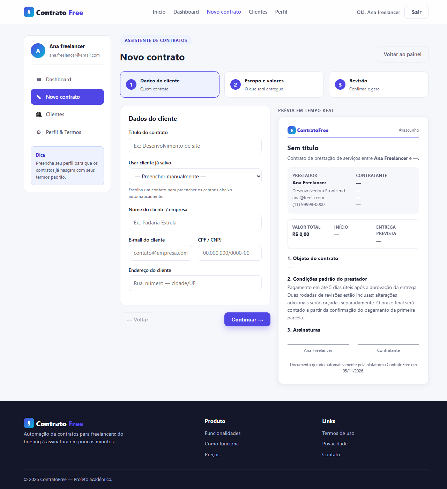
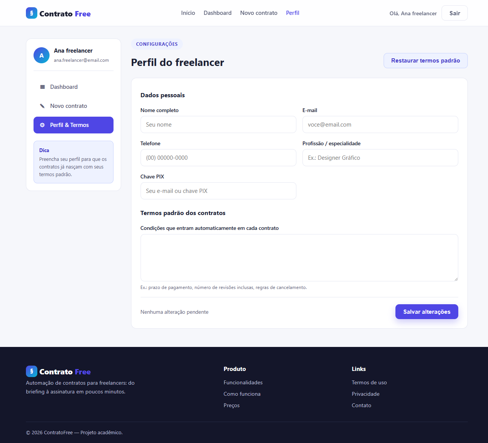
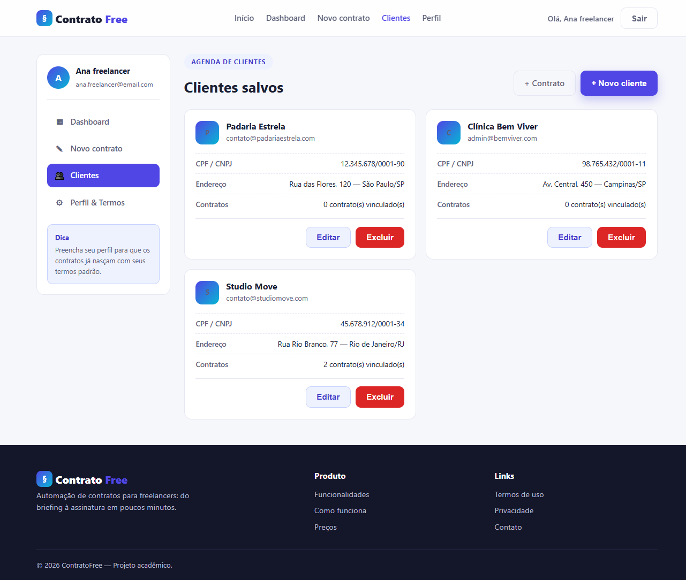

# 📄 ContratoFree — Automação de Contratos para Freelancers

> Plataforma web desenvolvida em **React.js + TypeScript (Vite)** para automatizar o
> fechamento e a geração de contratos de prestação de serviços por freelancers.

O freelancer preenche um wizard curto (cliente → escopo e valores → revisão), a
plataforma monta o contrato com os termos padrão salvos no perfil, exibe uma prévia em
tempo real e permite salvar, acompanhar métricas no dashboard e exportar o documento
em PDF/impressão.

**Funcionalidades completas de gestão:**

- ✏️ **Editar contratos** (`/novo-contrato/:id`) — abra qualquer contrato pelo dashboard
  e refaça as etapas do wizard com os dados já preenchidos;
- 🗑️ **Excluir contratos** — com modal de confirmação no painel;
- ✍️ **Assinatura do contrato** — botão “Assinar contrato” abre um modal em que o
  assinante **desenha a assinatura em um canvas** (ou apenas confirma o nome): o app
  **detecta e grava automaticamente a data/hora da assinatura**, muda o status para
  *Assinado* e exibe o carimbo no card, nos detalhes, na prévia e no PDF;
- 👥 **Agenda de clientes** (`/clientes`) — cadastro, edição e exclusão de clientes,
  com contagem de contratos vinculados;
- 💾 **Persistência** — contratos, clientes e perfil ficam salvos (localStorage no modo
  mock) e sobrevivem ao F5; os clientes são reutilizáveis no wizard por um seletor.

---

## 🚀 Instalação e execução

Pré-requisitos: [Node.js](https://nodejs.org) LTS (>= 18) e npm.

```bash
# 1. Clone o repositório
git clone https://github.com/<seu-usuario>/contrato-free.git
cd contrato-free

# 2. Instale as dependências
npm install

# 3. (Opcional) configure a URL do backend REST — ver seção "Integração com API"
copy .env.example .env      # Windows
# cp .env.example .env      # macOS/Linux

# 4. Inicie o ambiente de desenvolvimento
npm run dev
```

A aplicação ficará disponível em **http://localhost:5173**.

### Scripts disponíveis

| Comando           | Descrição                                  |
| ----------------- | ------------------------------------------ |
| `npm run dev`     | Sobe o servidor de desenvolvimento (Vite)  |
| `npm run build`   | Gera o build de produção em `dist/`        |
| `npm run preview` | Visualiza o build de produção localmente   |
| `npm run lint`    | Executa o linter (oxlint)                  |

---

## 🧩 Estrutura do projeto

```
src/
├── components/            # Componentes funcionais reutilizáveis
│   ├── Header.tsx         # Barra de navegação superior
│   ├── Footer.tsx         # Rodapé institucional
│   ├── Sidebar.tsx        # Menu lateral do painel
│   ├── Button.tsx         # Botão genérico com variantes
│   ├── Input.tsx          # Input / Textarea / Select (label, erro e hint)
│   ├── Modal.tsx          # Modal acessível (fecha com ESC)
│   ├── ContractCard.tsx   # Card de contrato na listagem
│   ├── ContractPreview.tsx# Prévia do contrato (área de impressão)
│   ├── Metric.tsx         # Card de métrica do dashboard
│   ├── SignaturePad.tsx   # Canvas de assinatura (desenho + limpar)
│   └── ProtectedRoute.tsx # Rota protegida por autenticação
├── context/
│   └── AuthContext.tsx    # Estado global de autenticação (useContext)
├── hooks/
│   ├── useContracts.ts    # Custom hook de contratos (CRUD + assinar)
│   ├── useClients.ts      # Custom hook da agenda de clientes (CRUD)
│   └── useLocalStorage.ts # Custom hook de persistência
├── pages/                 # 6 páginas / rotas
│   ├── Home.tsx           # /                    → Landing page
│   ├── Login.tsx          # /login               → Autenticação
│   ├── Dashboard.tsx      # /dashboard           → Contratos + métricas + editar/excluir/assinar
│   ├── NovoContrato.tsx   # /novo-contrato       → Wizard de geração
│   │                      # /novo-contrato/:id   → Edição de contrato
│   ├── Clientes.tsx       # /clientes            → Agenda de clientes (CRUD)
│   └── Perfil.tsx         # /perfil              → Dados e termos padrão
├── services/
│   └── api.ts             # Camada de API (mock + fetch pronto p/ backend real)
├── types/
│   └── index.ts           # Tipos compartilhados (Contract, Profile…)
├── App.tsx                # Configuração das rotas (react-router-dom)
└── main.tsx               # Ponto de entrada (BrowserRouter + AuthProvider)
```

### Hooks utilizados

- `useState` — formulários do login, wizard do contrato, perfil e agenda de clientes.
- `useEffect` — busca inicial dos contratos/clientes, carregamento do perfil, sessão e
  pré-carregamento do contrato em modo edição.
- `useContext` — estado global de autenticação (`useAuth`).
- `useRef` — referência da div do contrato para impressão/exportação em PDF.
- **Custom hooks** — `useContracts` (CRUD de contratos), `useClients` (CRUD de
  clientes) e `useLocalStorage` (persistência).

---

## 🔌 Integração com API (ponto extra)

A pasta `src/services/api.ts` expõe as funções `getContracts`, `createContract`,
`updateContract`, `deleteContract`, `signContract`, `getClients`, `saveClient`,
`updateClient`, `deleteClient`, `getProfile` e `updateProfile`.

- **Modo mock (padrão):** enquanto `VITE_API_URL` não estiver definida, as funções
  retornam `Promise`s com dados simulados e latência de rede — e **persistem contratos,
  clientes e perfil no `localStorage`** (sobrevivem ao F5).
- **Backend real:** crie o arquivo `.env` na raiz com a URL do seu backend Node.js:

```env
VITE_API_URL=http://localhost:3001
```

Basta o backend implementar os endpoints REST abaixo (mesmos nomes já usados no mock):

| Método | Endpoint          | Descrição                             |
| ------ | ----------------- | ------------------------------------- |
| GET    | `/contracts`      | Lista os contratos                    |
| POST   | `/contracts`      | Cria um novo contrato                 |
| PUT    | `/contracts/:id`  | Atualiza (edita) um contrato          |
| DELETE | `/contracts/:id`  | Exclui um contrato                    |
| POST   | `/contracts/:id/sign` | Assina o contrato (status + data/hora automática) |
| GET    | `/clients`        | Lista a agenda de clientes            |
| POST   | `/clients`        | Salva um cliente (upsert por e-mail)  |
| PUT    | `/clients/:id`    | Atualiza um cliente                   |
| DELETE | `/clients/:id`    | Exclui um cliente                     |
| GET    | `/profile`        | Retorna o perfil do freelancer        |
| PUT    | `/profile`        | Atualiza o perfil                     |

> Não é preciso alterar os componentes: a troca é feita apenas em `services/api.ts`.

---

## 👥 Integração da equipe

> **Preencha a tabela abaixo com os dados do seu grupo.**

| Membro | Matrícula | Responsabilidade | Componentes/páginas desenvolvidos |
| ------ | --------- | ---------------- | --------------------------------- |
| _Nome_ | _Matrícula_ | _Role_         | _Ex.: Header, Footer, Home_       |
|        |            |                 |                                   |
|        |            |                 |                                   |
|        |            |                 |                                   |

---

## 🖼️ Prints das telas principais

> Substitua os exemplos pelas imagens dos seus prints (salve em `docs/print/` e
> referencie como ``).

### 1. Home (`/`)


### 2. Login (`/login`)


### 3. Dashboard (`/dashboard`)



### 4. Novo contrato (`/novo-contrato`)



### 5. Perfil (`/perfil`)



### 6. Clientes (`/clientes`)



### 7. Assinatura do contrato (modal com data/hora automática)


---

## 📦 Publicando no GitHub

1. Crie um repositório **público** vazio em <https://github.com/new>
   (sem README, sem .gitignore e sem license — o projeto já os possui).
2. Rode os comandos abaixo na pasta do projeto:

```bash
# Identificação (troque pelos dados reais do responsável pelo commit)
git config user.name "Seu Nome"
git config user.email "seu@email.com"

# Conecta o repositório local ao GitHub e envia o código
git remote add origin https://github.com/<seu-usuario>/contrato-free.git
git branch -M main
git push -u origin main
```

> Caso o Git não esteja no PATH da sua máquina, use o caminho completo do
> executável (ex.: `%USERPROFILE%\tools\mingit\cmd\git.exe push -u origin main`)
> ou instale o Git oficial em <https://git-scm.com/download/win>.

---

## ☁️ Deploy

### Vercel (recomendado)

1. Suba o código para um repositório público no GitHub.
2. Acesse [vercel.com/new](https://vercel.com/new) e importe o repositório.
3. A Vercel detecta automaticamente o projeto Vite. Mantenha:
   - **Framework preset:** Vite
   - **Build command:** `npm run build`
   - **Output directory:** `dist`
4. Se usar backend próprio, adicione a variável `VITE_API_URL` em
   *Settings → Environment Variables*.
5. Clique em **Deploy**. Como o React Router usa rotas internas, a Vercel já
   redireciona tudo para `index.html` automaticamente.

### Render

1. Crie um novo **Web Service** apontando para o repositório no GitHub.
2. Configure:
   - **Build Command:** `npm install && npm run build`
   - **Publish Directory:** `dist`
3. Adicione a variável de ambiente `VITE_API_URL` (se houver backend).
4. Clique em **Create Web Service**.

---

## ✅ Requisitos acadêmicos atendidos

- [x] React.js + TypeScript inicializado via **Vite**
- [x] **11 arquivos de componentes funcionais** em `src/components/` (13 componentes:
      `Input`, `Textarea` e `Select` contam como 3 — mínimo exigido: 8)
- [x] **6 páginas** com React Router: `/`, `/login`, `/dashboard`, `/novo-contrato`
      (e `/novo-contrato/:id` para edição), `/clientes`, `/perfil` (mínimo exigido: 5)
- [x] **7 hooks diferentes**: `useState`, `useEffect`, `useContext`, `useRef`
      + custom hooks `useContracts`, `useClients` e `useLocalStorage` (mínimo exigido: 4)
- [x] CRUD completo: editar/excluir contratos e cadastrar/editar/excluir clientes
      com persistência de dados
- [x] **Assinatura de contrato** com canvas, status automático para *assinado* e
      carimbo de data/hora registrado pelo app
- [x] Camada de API preparada para backend REST (`src/services/api.ts`)
- [x] README com instalação, equipe, prints e instruções de deploy
